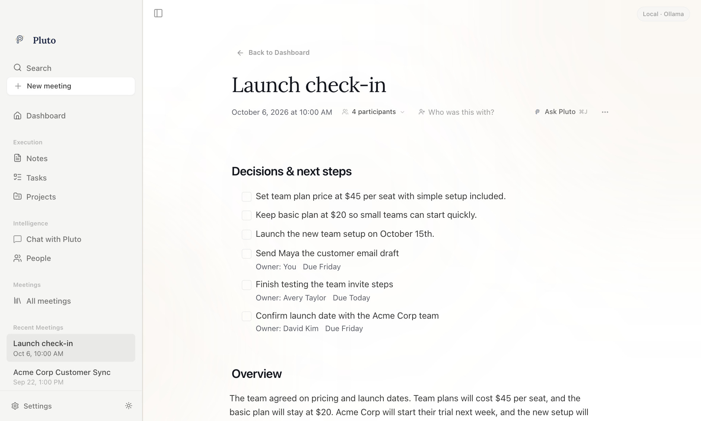
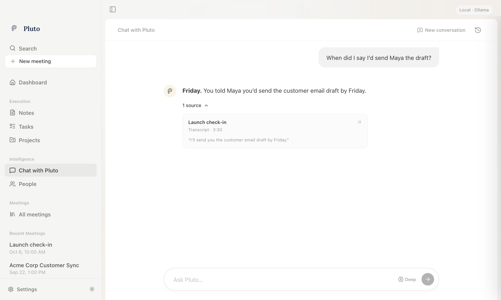
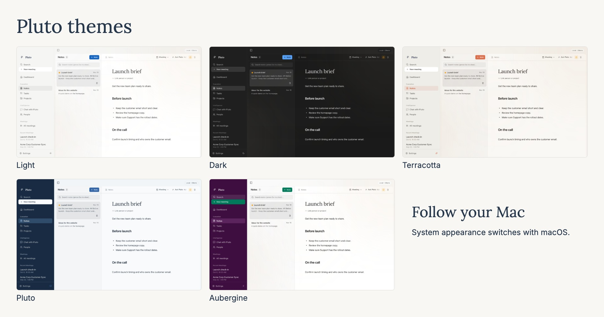

<p align="center">
  
</p>

<h1 align="center">Pluto</h1>

<h3 align="center">Your meetings, remembered.</h3>

<p align="center">
  Pluto listens to your meetings, writes the notes, keeps track of who promised what,<br />
  and answers questions about any past conversation. No bot joins your call.
</p>

<p align="center">
  <a href="#get-started"><strong>Get Pluto</strong></a> ·
  <a href="https://metagrover.github.io/get-pluto/">Website</a> ·
  <a href="#see-it-in-action">Demo</a> ·
  <a href="#privacy">Privacy</a> ·
  <a href="#faq">FAQ</a>
</p>

<p align="center"><sub>Free and open source · Apple Silicon Macs · Runs on your Mac</sub></p>

<a id="see-it-in-action"></a>

https://github.com/user-attachments/assets/edbfcc31-2b37-4648-b18a-c0b14b11973d

## What Pluto does

**Takes the notes.** Press record and keep talking. Pluto captures your mic and
your Mac's audio, so it works in Zoom, Meet, Teams, or any app. When you stop, you
get a summary, decisions, and next steps.

**Keeps the follow-ups.** Meeting commitments and your own tasks share one list,
with due dates and reminders. Pick up to five for today.

**Answers your questions.** Ask "What did we decide about pricing?" or "What do
I owe Sam?" and get an answer with links to the conversations behind it. Ask Pluto
can also draft a note or task change. You review it, click Apply, and can undo it.

**Remembers people and projects.** Every person and project gets a page with
their history, decisions, and open work. Voice ID recognizes familiar voices, so you
can follow who said what.

**Holds your own notes too.** Write briefs, ideas, and agendas next to your
meeting notes, link them to people and projects, and turn any line into a task.



## Private by default

Recording and transcription always happen on your Mac. For notes and answers,
choose where the AI runs:

| Option | What you need | Where your text goes |
| --- | --- | --- |
| **On your Mac** | [Ollama](https://ollama.com/download/mac), free | Nowhere. Works offline. |
| **Your ChatGPT plan** | ChatGPT Plus or Pro sign-in | OpenAI, using your plan |
| **OpenRouter** | An OpenRouter API key | Your chosen model provider |

You can switch at any time in **Settings → Intelligence**.

## Get started

You need an **Apple Silicon Mac (M1 or later)** running **macOS 14.2 or later**.

**1. Install Pluto**

```sh
curl -fsSL https://raw.githubusercontent.com/metagrover/pluto/master/scripts/install-macos.sh | bash
```

Setup downloads the speech models and asks for microphone and system-audio
access. Calendar access is optional.

**2. Pick your AI.** For on-device AI, install and open
[Ollama](https://ollama.com/download/mac), then run:

```sh
ollama pull gemma4:12b && ollama pull phi4-mini:3.8b
```

Or choose ChatGPT or OpenRouter during setup.

**3. Record a meeting.** Tell everyone you're recording, click **New meeting**,
and stop when you're done. Pluto transcribes the meeting and writes your notes.

[Full setup guide and troubleshooting →](docs/getting-started.md)

## A closer look

**Ask across all your meetings, and check the source.**



**Use your notes in ChatGPT or Claude.** Optional, read-only connections let
ChatGPT Desktop and Claude Desktop on the same Mac search your meeting notes.
Turn on either one, or neither.
[ChatGPT →](docs/chatgpt-connection.md) · [Claude →](docs/claude-connection.md)

**Make it yours.** Choose Light, Dark, Terracotta, Pluto, or Aubergine, or follow your Mac.



## Privacy

- **Audio and transcripts stay on your Mac.** Nothing is uploaded to record or
  transcribe.
- **On-device AI sends nothing anywhere.** If you choose ChatGPT or OpenRouter,
  Pluto sends that provider only the text a task needs, such as a transcript,
  notes, or related context.
- **Encryption is your choice.** You can encrypt the database during setup.
  Audio files are not encrypted by default.
  [Storage details →](docs/getting-started.md#privacy-and-data)
- **ChatGPT and Claude note access are off until you turn them on.** When on,
  that app can read your meeting notes, but never raw transcripts or audio.
  Turning a connection off stops future reads. Notes already shared stay in that app.

AI can get things wrong. Notes, answers, and speaker names link back to the
transcript so you can check. Always let people know when you're recording.

## FAQ

**Does it work offline?** Yes. Once the speech and Ollama models are downloaded,
recording, notes, and chat all work without the internet.

**What does it cost?** Pluto is free and open source. With on-device AI, you need
no account or API key. ChatGPT and OpenRouter use their own pricing.

**Does it run on Intel, Windows, or Linux?** Not yet. Pluto needs an Apple Silicon Mac.

**Where can I get help?** See the [setup guide](docs/getting-started.md), or use
**Help → Report a Problem** in Pluto. That prepares a report you can review before
sending. Keep private meeting content out of public issues.

## Build and contribute

The [developer guide](docs/dev.md) shows how to run Pluto from source, and the
[architecture overview](docs/architecture.md) explains the codebase. Bug reports
and focused pull requests are welcome. See [releases](https://github.com/metagrover/pluto/releases)
for downloads and changes.

## License

[MIT](LICENSE). Third-party code, fonts, and models keep their own licenses:
[FluidAudio](native/parakeet-runtime/vendor/FluidAudio/LICENSE),
[transcription notices](resources/model-manifests/FluidAudio-NOTICE.txt),
[model manifest](resources/model-manifests/parakeet-tdt-0.6b-v3.json),
[Inter](src/assets/fonts/pluto-site/Inter-LICENSE.txt), and
[Lora](src/assets/fonts/pluto-site/Lora-LICENSE.txt).
