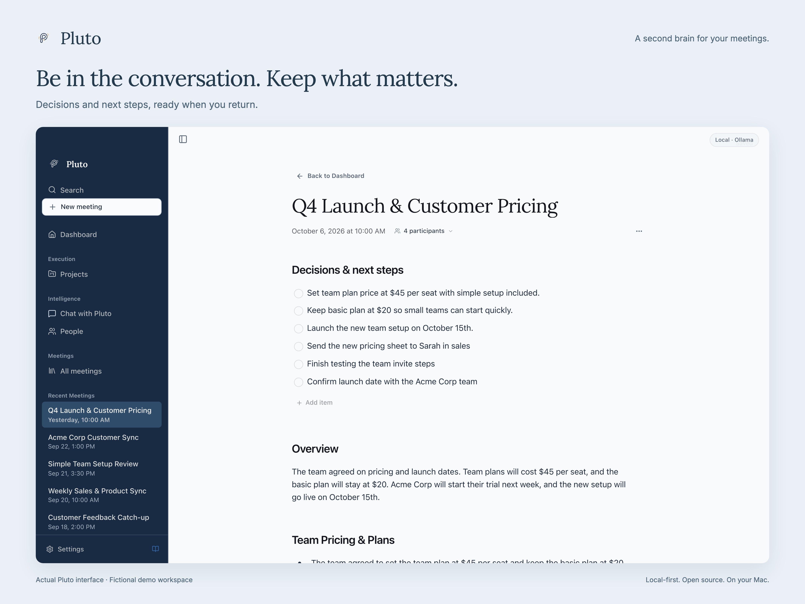
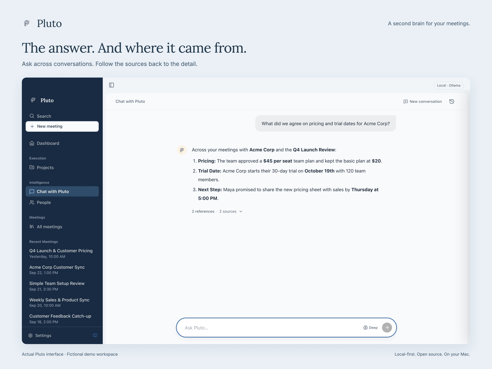
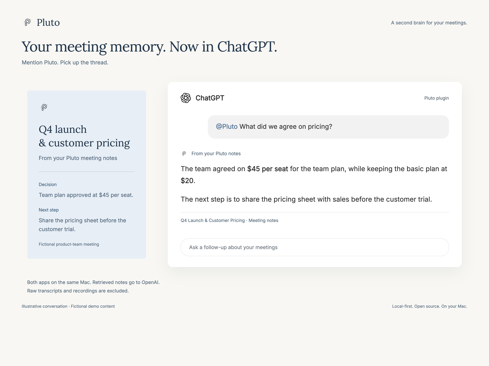
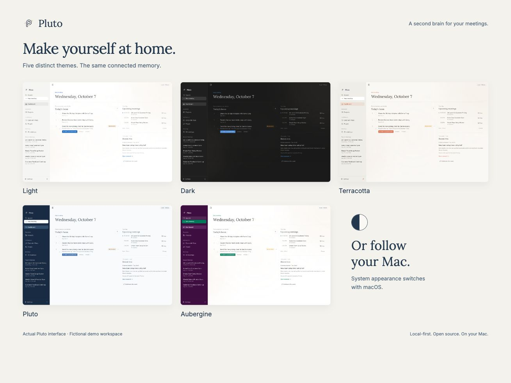

<p align="center">
  
</p>

<h1 align="center">Pluto</h1>

<h2 align="center">Intelligent meeting notes <em>for Mac.</em></h2>

<p align="center">Pluto takes the notes, tracks who promised what, and reminds you to follow through.</p>

<p align="center">
  <a href="#get-started">Get Pluto</a> ·
  <a href="#see-pluto-in-action">Demo</a> ·
  <a href="#features">Features</a> ·
  <a href="#explore-pluto">Screenshots</a> ·
  <a href="#privacy">Privacy</a> ·
  <a href="#faq">FAQ</a>
</p>

Pluto is a local-first, open-source meeting notes app for Apple Silicon Macs.
Record without a bot, transcribe on your Mac, and return to the people, projects,
and follow-ups that matter.

## See Pluto in action

<video src="https://github.com/user-attachments/assets/edbfcc31-2b37-4648-b18a-c0b14b11973d" width="960" controls></video>

## Features

- **Chat with Pluto about a meeting, person, or project.** Ask follow-up questions
  in a meeting chat, focus on someone’s history, or explore a project—with
  references back to the conversations.
- **Keep people and projects organized.** See their past conversations,
  decisions, and next steps in one place.
- **Track everyone’s commitments.** Keep track of who promised what across
  conversations, including your own follow-ups. Get reminders for confirmed
  commitments with due dates.
- **Follow project milestones.** Keep milestones, decisions, and open work
  connected to the meetings behind them.
- **Recognize familiar voices with Voice ID.** Confirm speaker matches and
  correct them when needed, so you can follow who said what.
- **Record without a bot.** Capture your microphone and Mac’s audio directly,
  then review transcripts, notes, and next steps.
- **Choose where AI runs.** Use local models through Ollama or an optional cloud provider.
- **Bring notes into ChatGPT.** Enable the optional connection on the same Mac.
  [See what’s shared →](#privacy)

## How it works

1. **Record.** Start a meeting in Pluto and carry on with your conversation.
2. **Review.** Stop recording, let Pluto transcribe and generate notes, then check
   the decisions and next steps.
3. **Pick up the thread.** Ask a question or explore the people and projects
   connected to your meetings.

Let participants know when you record. Generated notes, answers, and speaker
matches can be wrong—review the source when it matters.

## Get started

You’ll need an **Apple Silicon Mac (M1 or later)** with **macOS 14.2 or later**.
An internet connection is required for initial downloads.

### 1. Install Pluto

Press **⌘ + Space**, type **Terminal**, and press Return. Copy this command,
paste it into Terminal with **⌘ + V**, and press Return:

```sh
curl -fsSL https://raw.githubusercontent.com/metagrover/pluto/master/scripts/install-macos.sh | bash
```

Wait for Pluto to install and open. Follow setup to download its speech models
and allow microphone and system audio access. Calendar access is optional.

### 2. Set up Ollama

[Download Ollama for Mac](https://ollama.com/download/mac), move it into
**Applications**, and open it. Follow its prompt to enable the `ollama` Terminal
command. Keep Ollama open, then run this command in Terminal:

```sh
ollama pull gemma4:12b && ollama pull phi4-mini:3.8b
```

Wait for both downloads to finish. Pluto’s speech models handle transcription;
Ollama’s models handle notes and chat. New Pluto setups use Ollama and these
models by default—no settings to enter.

### 3. Try your first recording

Keep Ollama running and open Pluto. Let everyone know you’re recording, then
click **New meeting** and start a short recording. Stop and wait for Pluto to
finish generating notes, then open the meeting to review them and ask questions.

[Full setup guide and troubleshooting →](docs/getting-started.md)

## Explore Pluto

See how Pluto helps you return to a conversation.

### Meeting notes, decisions, and next steps

Review notes and next steps, then ask Pluto follow-up questions in the meeting’s
chat. Confirm familiar speakers with Voice ID and correct matches when needed.



### Ask Pluto and check the source

Ask across your meeting history, or focus the chat on a person or project.
Follow references back to the conversations behind the answer.



### People, projects, and follow-through

Open a person’s page to catch up on your conversations and their commitments.
Open a project’s page to review its decisions, milestones, and open work.
Track commitments for everyone involved, with reminders for confirmed due dates.

### Pick up the thread in ChatGPT

The optional Pluto plugin brings meeting notes into ChatGPT on the same Mac.
[Connect ChatGPT →](docs/chatgpt-connection.md)



*The ChatGPT conversation above is illustrative.*

### Themes and appearance

Choose Light, Dark, Terracotta, Pluto, Aubergine, or follow your Mac’s appearance.



## Privacy

- **Capture and transcription run on your Mac.** Local intelligence also stays
  on your Mac. Optional cloud AI sends the text needed for each operation to your
  chosen provider, which can include transcripts, notes, and retrieved context.
- **Database encryption is optional at setup.** Audio files are not encrypted
  by default. [Storage details →](docs/getting-started.md#privacy-and-data)
- **ChatGPT access is optional.** Enabling it makes all meeting notes available
  to read. Retrieved notes go to OpenAI; raw transcripts and audio are excluded.
  Disabling stops future reads; notes already shared remain in ChatGPT.

## FAQ

### Can I use Pluto offline?

Yes, after downloading the speech and Ollama models, local recording,
transcription, notes, and chat work without a cloud provider or API key. Cloud AI
and the optional ChatGPT connection need an internet connection.

### Do I need a subscription?

Pluto is free and open source. You can use local intelligence without an API key.
If you choose cloud AI or ChatGPT, their own pricing and access requirements apply.

### Does Pluto support Intel Macs, Windows, or Linux?

Currently, Pluto supports Apple Silicon Macs only.

### Where can I get help?

Start with the [setup guide and troubleshooting](docs/getting-started.md).
In Pluto, **Help → Report a Problem** prepares a report you can review before
sharing. Keep private meeting content and credentials out of public issues.

## Build and contribute

See the [developer guide](docs/dev.md) to run Pluto from source and the
[architecture overview](docs/architecture.md) to explore the codebase.
Bug reports and focused pull requests are welcome. Browse the
[releases](https://github.com/metagrover/pluto/releases) for downloads and changes.

## License

[MIT](LICENSE). Third-party code, fonts, and models retain their own licenses:
[FluidAudio](native/parakeet-runtime/vendor/FluidAudio/LICENSE),
[transcription notices](resources/model-manifests/FluidAudio-NOTICE.txt),
[model manifest](resources/model-manifests/parakeet-tdt-0.6b-v3.json),
[Inter](src/assets/fonts/pluto-site/Inter-LICENSE.txt), and
[Lora](src/assets/fonts/pluto-site/Lora-LICENSE.txt).
